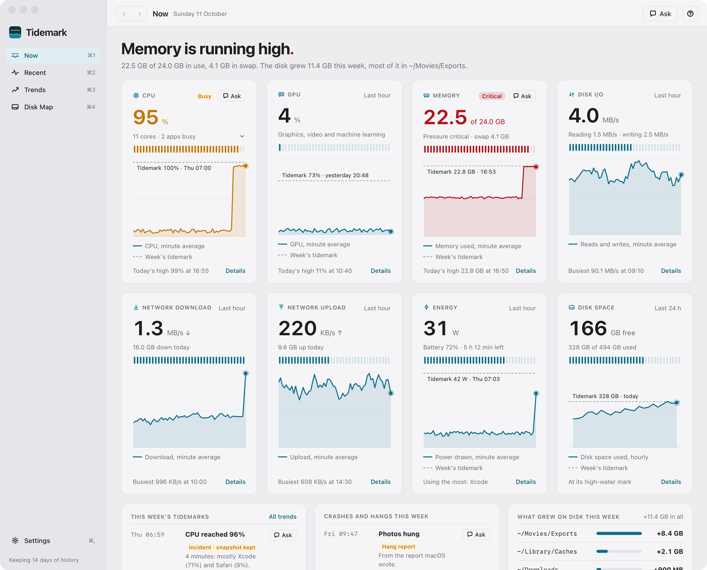
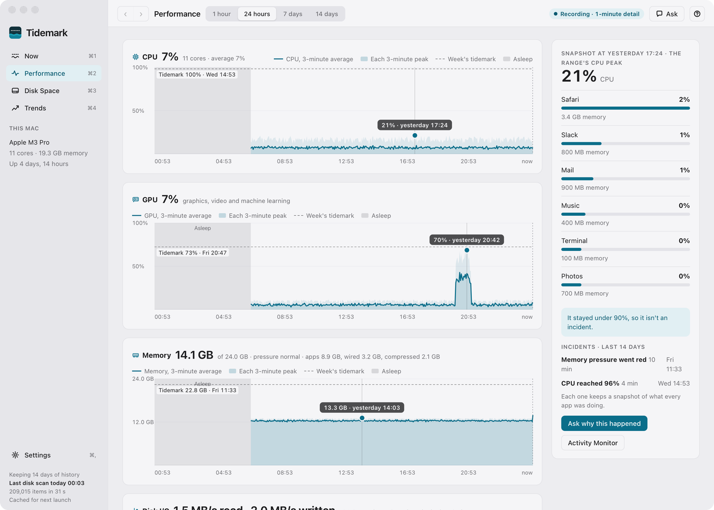
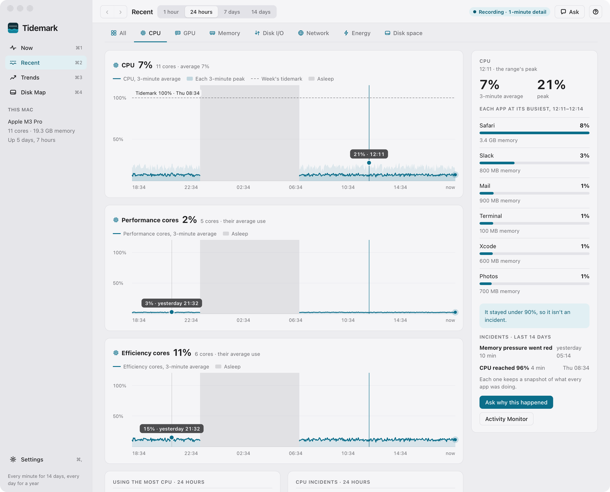
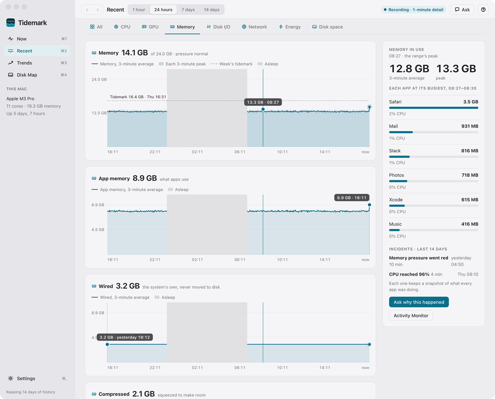
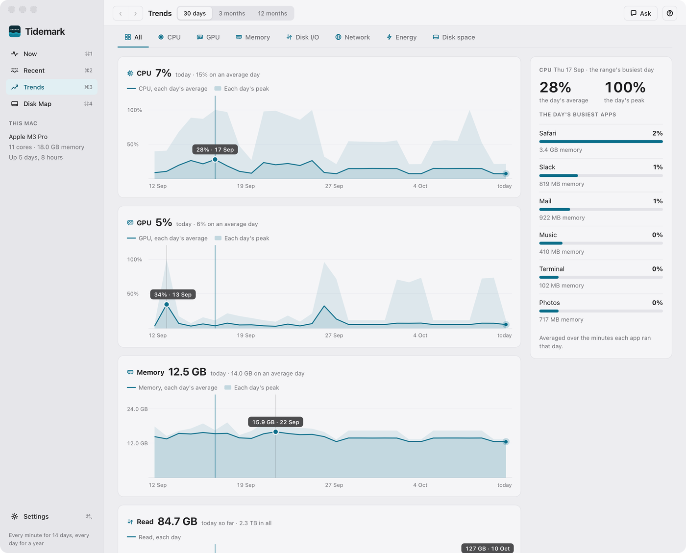
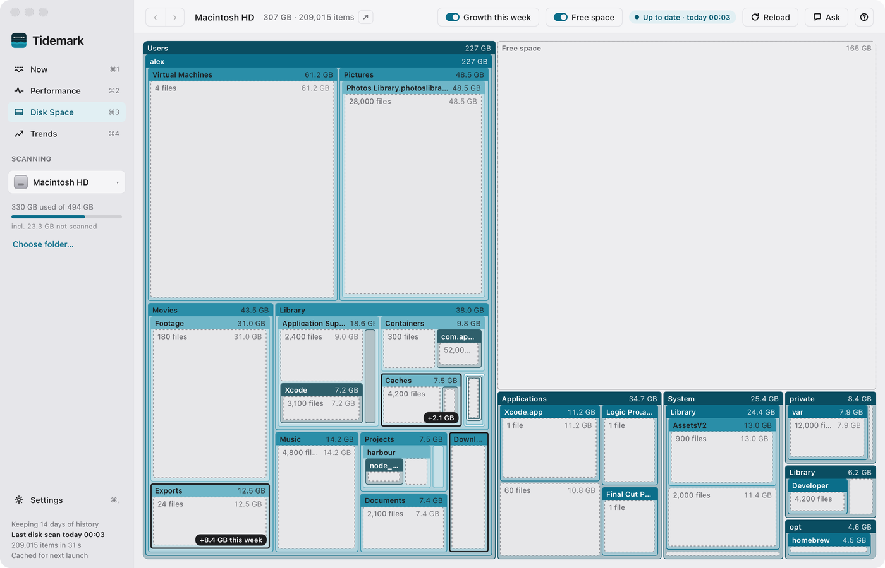
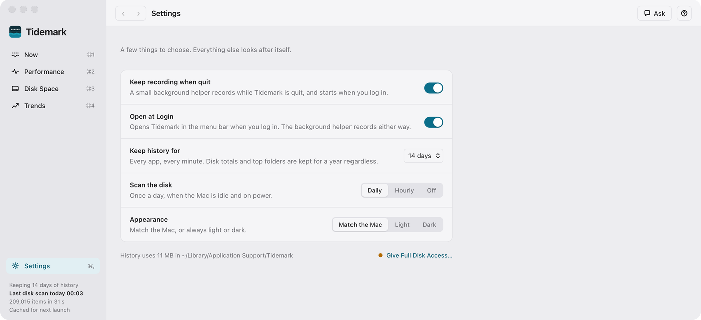
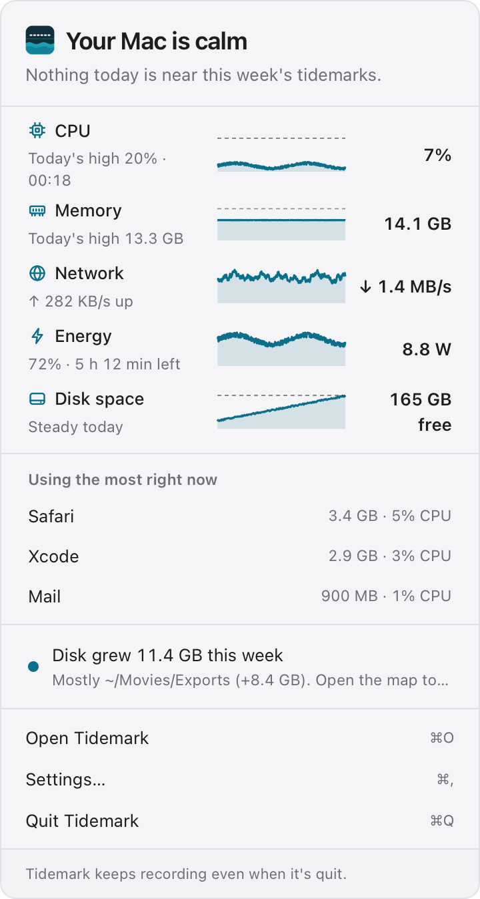

# Features

Tidemark's screens, briefly. The app's own help (press `?`) has the detail.

## Now (⌘1)

How your Mac is doing, at a glance.

<a href="images/index.md#now"><picture><source media="(prefers-color-scheme: dark)" srcset="images/now-dark.png"></picture></a>

- A sentence on how the Mac is doing; every measure needing attention coloured amber or red.
- Eight cards, each with a meter of how full it is now: CPU (with each core behind a chevron), GPU, memory, disk I/O, network download, network upload and energy over the last hour; disk space over the last 24 hours.
- The week's tidemarks, its crashes and hangs, and what grew on the disk, side by side.
- **Details** on a card opens Recent at its tab. A card flagged amber or red, and each incident and crash in the week's tidemarks, has an **Ask** button.
- Suggested questions along the foot open Ask. The sidebar's **This Mac** shows the chip, cores, memory and uptime.

## Recent (⌘2)

Every live measure in detail, over 1 hour to 14 days (up to the history kept).

<a href="images/index.md#recent"><picture><source media="(prefers-color-scheme: dark)" srcset="images/performance-dark.png"></picture></a>

- **All**: one chart a measure, each the same size and lined up in time. A tab for each measure (CPU, GPU, Memory, Disk I/O, Network, Energy, Disk space) gives it more room: a chart for each part (the CPU's performance and efficiency cores; memory's apps, wired, compressed, swap and pressure; reads and writes; download and upload), the apps that used the most, its incidents and busiest moments.
- Each point's peak as a band, the week's tidemark, the range's peak as a dot, the latest reading as a breathing dot.
- Click any moment, or a peak dot, to see the busiest apps then: by their average, at their busiest, or an incident's own snapshot. Apps are sorted by the chart's measure; GPU and network, which macOS doesn't split by app, by CPU.
- Disk space: used and free over the range, what grew this week, and what's using the space.
- Energy: the power drawn, the battery's charge, its health and cycles, and what the last sleep cost.
- **Incidents**: CPU above 90% for 30 seconds, memory pressure red, or swap up 1 GB in 10 minutes, each with a snapshot of the 12 busiest apps.
- Apps that crashed or hung, from macOS's own reports.

The CPU tab and the Memory tab:

<a href="images/index.md#recent"><picture><source media="(prefers-color-scheme: dark)" srcset="images/performance-cpu-dark.png"></picture></a> <a href="images/index.md#recent"><picture><source media="(prefers-color-scheme: dark)" srcset="images/performance-memory-dark.png"></picture></a>

## Trends (⌘3)

Every measure over a month to a year, a day at a time.

<a href="images/index.md#trends"><picture><source media="(prefers-color-scheme: dark)" srcset="images/trends-dark.png"></picture></a>

- A row a day for a year: every measure's average and peak, the day's totals, its incidents and its busiest apps. Tabs as on Recent, one chart a measure.
- Click a day to see its figures and busiest apps; each tab's records (busiest day, highest peak, busiest week) and when it's usually busy, by hour.
- Disk space over 30 days to 12 months: how fast it grows, when it would be full, and the folders that rose.

## Disk Map (⌘4)

What is using the disk: every folder as a block, sized by what it takes up. See [Disk Map](disk-map.md).

<a href="images/index.md#disk-map"><picture><source media="(prefers-color-scheme: dark)" srcset="images/disk-map-dark.png"></picture></a>

## Settings (⌘,)

<a href="images/index.md#settings"><picture><source media="(prefers-color-scheme: dark)" srcset="images/settings-dark.png"></picture></a>

| Setting | What it does |
|---|---|
| **Keep recording when quit** | A background helper records while the app is quit. |
| **Open at Login** | Starts Tidemark in the menu bar at login. |
| **Keep every minute for** | 14, 7 or 3 days of detail. |
| **Scan the disk** | Daily (idle and on power), hourly, or off (only when you press Reload). |
| **Appearance** | Match the Mac, light or dark. |

Below them, About shows the version, with a **Website** button. The foot shows how much space the history takes and whether Tidemark has Full Disk Access, with a link to grant it.

In a development build the two switches are disabled. When the helper has been switched off in System Settings, Settings says so.

## Menu bar

Closing the window keeps Tidemark recording in the menu bar.

<a href="images/index.md#menu-bar"><picture><source media="(prefers-color-scheme: dark)" srcset="images/menu-bar-dark.png"></picture></a>

- The icon is marked when something needs attention.
- Click it for CPU, memory, network, energy and disk space, each with a meter and its last hour; click one to open Recent at its tab.
- Below them, what is using the most, a line about the week, and the action that helps.
- At the foot, **Open Tidemark** (⌘O), **Settings** (⌘,) and **Quit** (⌘Q).

## Ask (⌘K)

A chat with an AI about your Mac, through a command-line tool already signed in on it (Claude Code, Codex, Antigravity or GitHub Copilot).

- Ask why the Mac was slow, or where space can be freed safely.
- It sees names, sizes and figures only, and Tidemark changes nothing.

## Charts

- Lines are averages and run up to now; a band behind shows each point's peak.
- A dashed line is the tidemark: the high-water mark.
- Sleep is shaded **Asleep**; time Tidemark wasn't running is hatched **Not recording**.
- The measure that needs attention turns amber (warning) or red (critical).
