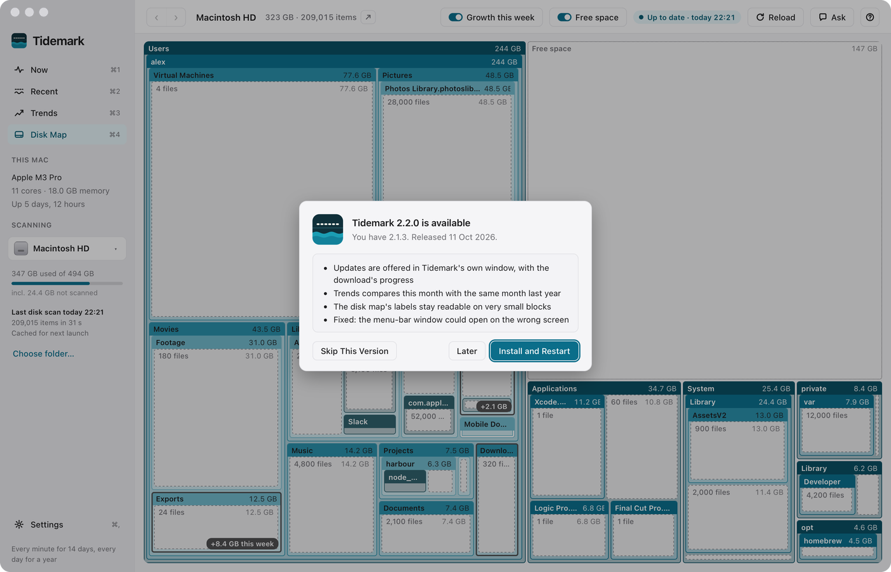

# Features

Tidemark's screens, briefly. The app's own help (press `?`) has the detail.<!-- github --> Tidemark runs on macOS and Windows; a few things differ on Windows: see [On Windows](#on-windows).<!-- /github -->

## Now (⌘1)

How your computer is doing, at a glance.

<a href="images/index.md#now"><picture><source media="(prefers-color-scheme: dark)" srcset="images/now-dark.png"></picture></a>

- A sentence on how the computer is doing; every measure needing attention coloured amber or red.
- Eight cards, each with a meter of how full it is now: CPU (with each core behind a chevron), GPU, memory, disk I/O, network download, network upload and energy over the last hour; disk space over the last 24 hours.
- The apps using the most memory, CPU, disk I/O and energy right now, live, each with an icon.
- The week's tidemarks, its crashes and hangs, and what grew on the disk, side by side.
- **Details** on a card opens Recent at its tab. A card flagged amber or red, each incident in the week's tidemarks and each crash in Crashes and hangs has an **Ask** button.
- Suggested questions along the foot open Ask. The sidebar's **This <!-- mac -->Mac<!-- /mac --><!-- github --> (or <!-- /github --><!-- windows -->PC<!-- /windows --><!-- github -->)<!-- /github -->** shows the chip, cores, memory and uptime.

## Recent (⌘2)

Every live measure in detail, over 1 hour to 14 days (up to the history kept).

<a href="images/index.md#recent"><picture><source media="(prefers-color-scheme: dark)" srcset="images/performance-dark.png"></picture></a>

- **All**: one chart a measure, each the same size and lined up in time. A tab for each measure (CPU, GPU, Memory, Disk I/O, Network, Energy, Disk space) gives it more room: a chart for each part (the CPU's performance and efficiency cores; memory's apps, <!-- mac -->wired<!-- /mac --><!-- github --> (non-paged on Windows)<!-- /github --><!-- windows -->non-paged<!-- /windows -->, compressed, swap and pressure; reads and writes; download and upload), the apps that used the most, its incidents and busiest moments.
- Each point's peak as a band, the week's tidemark, the range's peak as a dot, the latest reading as a breathing dot.
- Click any moment, or a peak dot, to see the busiest apps then: by their average, at their busiest, or an incident's own snapshot. Apps are sorted by the chart's measure; GPU and network, which <!-- mac -->macOS<!-- /mac --><!-- github --> or <!-- /github --><!-- windows -->Windows<!-- /windows --> doesn't split by app, by CPU.
- Disk space: used and free over the range, what grew this week, and what's using the space.
- Energy: the power drawn<!-- windows --> (on Windows, while on battery)<!-- /windows -->, the battery's charge, its health and cycles, and what the last sleep cost.
- **Incidents**: CPU above 90% for 30 seconds, memory pressure red, or swap up 1 GB in 10 minutes, each with a snapshot of the 12 busiest apps.
- Apps that crashed or hung, from <!-- mac -->macOS's own reports<!-- /mac --><!-- github --> or <!-- /github --><!-- windows -->Windows' Application event log<!-- /windows -->.

The CPU tab and the Memory tab:

<a href="images/index.md#recent"><picture><source media="(prefers-color-scheme: dark)" srcset="images/performance-cpu-dark.png"></picture></a> <a href="images/index.md#recent"><picture><source media="(prefers-color-scheme: dark)" srcset="images/performance-memory-dark.png"></picture></a>

## Trends (⌘3)

Every measure over a month to a year, a day at a time.

<a href="images/index.md#trends"><picture><source media="(prefers-color-scheme: dark)" srcset="images/trends-dark.png"></picture></a>

- A row a day for a year: every measure's average and peak, the day's totals, its incidents and its busiest apps. Tabs as on Recent, one chart a measure.
- Click a day to see its figures and busiest apps; each tab's records (busiest day, highest peak, busiest week) and when it's usually busy, by hour.
- Disk space over 30 days to 12 months: how fast it grows, when it would be full, and the folders that rose.

## Disk Map (⌘4)

What is using the disk: every folder as a block, sized by what it takes up. See [Disk Map](disk-map.md).

<a href="images/index.md#disk-map"><picture><source media="(prefers-color-scheme: dark)" srcset="images/disk-map-dark.png"></picture></a>

## Settings (⌘,)

<a href="images/index.md#settings"><picture><source media="(prefers-color-scheme: dark)" srcset="images/settings-dark.png"></picture></a>

| Setting | What it does |
|---|---|
| **Keep recording when quit** | A background helper records while the app is quit. |
| **Open at Login** | Starts Tidemark in the <!-- mac -->menu bar<!-- /mac --><!-- github --> (Mac) or <!-- /github --><!-- windows -->notification area<!-- /windows --><!-- github --> (Windows)<!-- /github --> when you <!-- mac -->log in<!-- /mac --><!-- github --> or <!-- /github --><!-- windows -->sign in<!-- /windows -->. |
| **Keep every minute for** | 14, 7 or 3 days of detail. |
| **Scan the disk** | Daily (idle and on power), hourly, or off (only when you press Reload). Unless it's off, opening Tidemark also scans if the last scan is over an hour old. |
| **Appearance** | Match <!-- mac -->macOS<!-- /mac --><!-- github --> (or <!-- /github --><!-- windows -->Windows<!-- /windows --><!-- github -->)<!-- /github -->, light or dark. |

Below them, About shows the version, with a **Website** button<!-- windows --> and, on Windows, **Check for Updates…**<!-- /windows -->. The foot shows how much space the history takes and where<!-- mac -->, and whether Tidemark has Full Disk Access, with a link to grant it<!-- /mac -->.

In a development build the two switches are disabled. When the helper has been switched off in <!-- mac -->System Settings<!-- /mac --><!-- github --> or <!-- /github --><!-- windows -->Windows' Startup apps<!-- /windows -->, Settings says so.

## Updates

Tidemark checks for a new version shortly after it opens and then daily, and asks in its own window: **Install and Restart**, **Later** (Esc) or **Skip This Version**, with the release's notes. Installing shows the download's progress, then restarts Tidemark and the background helper. <!-- mac -->Tidemark › Check for Updates…<!-- /mac --><!-- github --> on a Mac, or <!-- /github --><!-- windows -->**Check for Updates…** in Settings or the notification-area window<!-- /windows --><!-- github --> on Windows,<!-- /github --> checks now.

<a href="images/index.md#updates"><picture><source media="(prefers-color-scheme: dark)" srcset="images/update-dark.png"></picture></a>

## <!-- mac -->Menu bar<!-- /mac --><!-- github --> or <!-- /github --><!-- windows -->Notification area<!-- /windows -->

Closing the window keeps Tidemark recording in the <!-- mac -->menu bar<!-- /mac --><!-- github --> (Mac) or <!-- /github --><!-- windows -->notification area<!-- /windows --><!-- github --> (Windows)<!-- /github -->.

<a href="images/index.md#menu-bar"><picture><source media="(prefers-color-scheme: dark)" srcset="images/menu-bar-dark.png"></picture></a>

- The icon is marked when something needs attention<!-- windows --> (on Windows, with an amber dot)<!-- /windows -->.
- Click it for CPU, memory, network, energy and disk I/O, each with a meter and its last hour; click one to open Recent at its tab.
- Below them, the apps using the most of whatever is tightest right now (the measure needing attention, or else whichever of CPU and memory is nearer its limit), which open Now's list of them; a line about the week; and the action that helps.
- At the foot, **Open Tidemark** (⌘O), **Settings** (⌘,)<!-- windows -->, **Tidemark Help** (⌘?), **Check for Updates…**<!-- /windows --><!-- github --> (those two on Windows only)<!-- /github --> and **Quit** (⌘Q). ⌘1, ⌘2 and ⌘4 open Now, Recent and Disk Map; Esc closes the window.

## Ask (⌘K)

A chat with an AI about your computer, through a command-line tool already signed in on it (Claude Code, Codex, Antigravity or GitHub Copilot).<!-- windows --> On Windows, the tool must be installed in your own Windows account (see [On Windows](#on-windows)).<!-- /windows -->

- Ask why the computer was slow, or where space can be freed safely.
- It sees names, paths, sizes and figures, and a crash report's summary when you ask about one, and Tidemark changes nothing.

## Charts

- Lines are averages and run up to now; a band behind shows each point's peak.
- A dashed line is the tidemark: the high-water mark.
- Sleep is shaded **Asleep**; time Tidemark wasn't running is hatched **Not recording**.
- The measure that needs attention turns amber (warning) or red (critical).

## Keyboard

| Keys | What they do |
|---|---|
| ⌘1 ⌘2 ⌘3 ⌘4 | Now, Recent, Trends, Disk Map |
| ⌘, | Settings |
| ⌘K | Ask |
| ⌘[ and ⌘] | Back and forward, across screens and folders |
| ⌘R | Scan again |
| ⌘O | Choose a folder to scan |
| ? | Help for the screen you're on |

<!-- windows -->
## On Windows

Tidemark works the same on Windows 10 and 11 (64-bit), with these differences:

| | On Windows |
|---|---|
| Install | `Tidemark_x64-setup.exe` from the [latest release](https://github.com/waynetd777/tidemark/releases/latest), for you alone, with no administrator password. It isn't code-signed, so SmartScreen warns: **More info**, then **Run anyway**. Updates download and install quietly with a progress window, and reopen the app |
| Shortcuts | Ctrl in place of ⌘, as the app and its help show them; Ctrl+? opens the help anywhere in the main window |
| Notification area | In place of the menu bar, by the clock. The icon is Tidemark's own, with an amber dot when something needs attention; its window opens above it. There's no Dock: with the window closed, Tidemark is only there. With no app menu, its window has **Tidemark Help** and **Check for Updates…**, and Settings has **Website** and **Check for Updates…** at its foot |
| Your data | In `%LOCALAPPDATA%\com.wayned.tidemark`. Uninstalling in Windows Settings › Apps with **Delete the application data** ticked removes the history |
| Paths | As Windows writes them (`C:\Users\…`). A whole-disk scan is of the system drive, named as File Explorer names it (Windows (C:) or Local Disk (C:)); other drives and folders can be chosen |
| Disk Map | **Reveal in File Explorer** and **Properties…**. No Full Disk Access: the folders a scan can't read are mostly ones only an administrator can open. Junctions and links count as themselves, never followed; files hard-linked across the Windows folder (WinSxS and System32) count once. OneDrive, iCloud for Windows and other cloud-files providers are recognised by Windows' own marks ([Disk Map](disk-map.md)) |
| CPU | The performance and efficiency cores apart only on processors with both (Intel's 12th generation and later) |
| GPU | Windows' GPU counters, the busiest engine, as Task Manager's GPU figure is |
| Memory | Apps and the system, **non-paged** (what macOS calls wired) and **compressed** (Windows' Memory Compression store); swap is the page file in use. Windows has no memory pressure, so Tidemark works it out on the same three levels from the commit charge, free memory and Windows' low-memory signal |
| Disk I/O | The disk's reads and writes from Windows' disk counters. Each app's figure counts all its reads and writes (files, network and devices), so it can be larger than the disk's |
| Energy | No energy by app: Windows doesn't measure it for programs. The power drawn shows only while on battery; a PC with no battery has no energy row in the small window. Battery health, and cycles where the battery reports them |
| Thermal | Whether Windows slowed the processor to cool it, in place of macOS's thermal state |
| Crashes and hangs | From Windows' Application event log (what Reliability Monitor shows) |
| Task Manager | In place of Activity Monitor, on Recent's card |
| Background helper and Open at Login | Started at sign-in from Windows' Startup list, as "Tidemark Helper" and "Tidemark" in Windows Settings › Apps › Startup |
| Ask | Each tool installed in your Windows account: Claude Code with `irm https://claude.ai/install.ps1 \| iex` in PowerShell, Codex with `npm install -g @openai/codex`, GitHub Copilot with `npm install -g @github/copilot`, Antigravity with its installer. Run each once in PowerShell to sign in. A tool installed after Tidemark started may need Tidemark restarted, or a sign-out and in, to be found |
<!-- /windows -->
